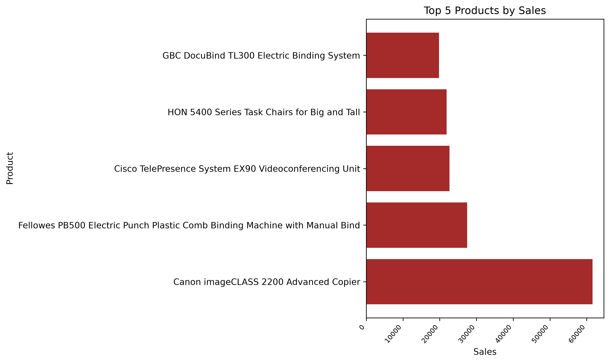
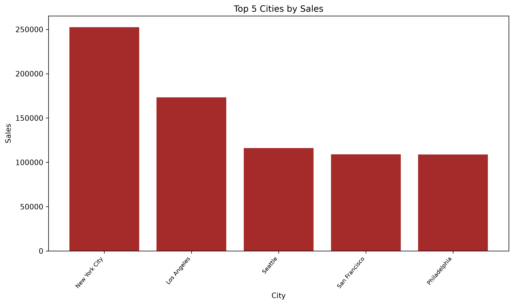

# Sales Data Analysis with Python

## Project Overview
This project explores and analyzes a sales dataset using Python and Pandas. The goal is to identify sales patterns, compare product and city performance, and summarize monthly sales trends.

## Dataset
- **Rows:** 9,800
- **Columns:** 18
- **Main features:** Order Date, Ship Date, City, Region, Category, Sub-Category, Product Name, and Sales.

## Tools & Libraries
- Python
- Pandas
- Matplotlib

## Data Preparation
- Inspected dataset structure and summary statistics.
- Checked missing values and duplicate records.
- Converted date columns to datetime format.
- Extracted year and month from order dates.
- Checked sales values and extra whitespace in text columns.

## Analysis
- Identified the top 5 products by total sales.
- Identified the top 5 cities by total sales.
- Calculated the average order value.
- Compared average order values in New York City and the overall dataset.
- Analyzed monthly sales across different years.
- Used a pivot table to compare yearly and monthly sales.

## Visualizations

### Top 5 Products by Sales


### Top 5 Cities by Sales


### Monthly Sales


## Key Findings
- New York City had the highest total sales among the cities analyzed.
- Canon imageCLASS 2200 Advanced Copier was the top-selling product by total sales.
- November had the highest aggregate sales when combining all years.
- New York City's average order value was higher than the overall average order value.

## How to Run
1. Clone this repository.
2. Install the required libraries:
   ```bash
   pip install pandas matplotlib
   ```
3. Make sure `sales.csv` is in the project directory.
4. Run:
   ```bash
   python data_analyst.py
   ```

## Project Status
Completed.
